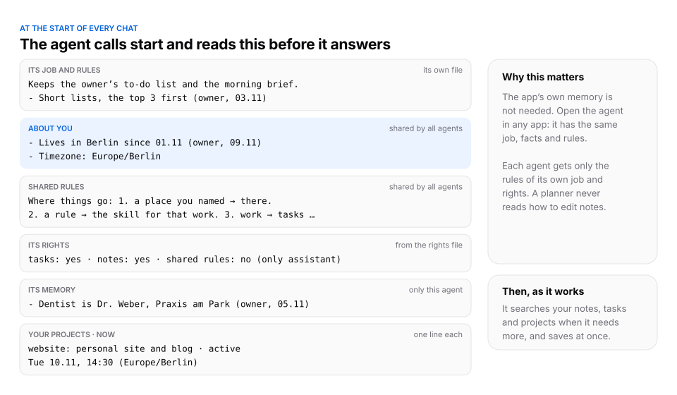

# ContextCore

**One knowledge base of your life and work, for all your AI agents, on your own server.**

https://github.com/user-attachments/assets/447a8788-01fc-42e5-b35f-124ac148b1a3

ContextCore is an open-source MCP server for Claude, ChatGPT, coding agents and any other app that supports remote
MCP servers.

## A knowledge base of your whole life and work

Everything that matters to you: projects, people, places, books, health, ideas, research, decisions, and the facts
every agent should know about you. Tell any agent something worth keeping, and it becomes a note in the right place,
linked to its topic.

## Every agent, in every app, uses it

Ask another agent in another app, or a coding agent in your terminal, and it finds what you saved and combines it.
An agent is a name, not an app: start "planner" anywhere, and it has the same rules and memory.

## See it all, on the web or in Obsidian

Everything lives on your own server as plain Markdown files with front matter and [[wiki links]], in git.

- **On the web.** Your server has a private read-only page: notes, tasks, projects, and each agent's rules and
  memory, with search. It works on the phone and can be added to the home screen.
- **In Obsidian.** Clone the private git backup to your laptop and open the folder as a vault: notes, links and the
  graph are all there, and a git plugin keeps it up to date. The steps are in INSTALL.md, section 10.

Agents save as you talk; your main agent proposes tidy-ups (duplicates, missing links, hub pages) and changes
nothing before your yes.

## Install

Give an AI agent that can use a terminal and SSH (for example Claude Code) this repo's link and say:

> Install ContextCore on my server. Follow INSTALL.md.

The agent installs and checks the server, helps you connect your apps, and moves in what you already have: each
app's memory, your notes and your projects. You need a Linux server; the daily review needs an app that can run
scheduled tasks.

## How it works

<picture>
  <source media="(prefers-color-scheme: dark)" srcset="docs/at-start-dark.svg">
  
</picture>

At the start of every chat the agent calls `start` and reads its job, the facts about you, the shared rules, its
rights, its own memory, your projects and the time. Then `run` takes a short program
(`nm.read / list / find / write / save_task`) that reads and saves in one step, in a sandbox with no network or
files; `whats_new` shows what other agents changed. The server checks rights and formats, and a refused save is
never half-done. Your own notes weigh most; an agent's memory and logs are marked as the agent's.

## How it differs

**Built-in app memory** (the memory of a chat app). Easy, and it works inside one app. It stays there: other apps
can't read it, you can't see or fix it as a whole, and nothing cleans it. ContextCore moves each app's memory in
at setup, and from then on the app keeps one line that points to ContextCore.

**Rules files** (CLAUDE.md, AGENTS.md, custom instructions). Clear and versioned, but one per tool or project,
copied by hand, and an agent can't save what it learns into them safely. In ContextCore the rules live in one
place, each agent reads only the rules of its own job and rights, and changes to shared rules wait for your yes.

**Vector memory services** (they extract snippets from chats and return similar ones). Good at recall, but the
memory is a cloud of fragments: no clear place for a rule, a task or a project, no idea which fragment is your word
and which is a model's guess, and usually someone else's server. ContextCore stores whole, readable files in
places you know, says where each item came from and when, and runs on your own server.

**A notes vault with an MCP server** (a folder of Markdown files that agents can read). Your files and your
structure, but every agent invents its own way to write there, so the vault slowly turns into a mix of styles,
duplicates and orphan notes. ContextCore gives every agent the same rules for where things go, types for notes,
dates and sources on facts, and a review that keeps it in order.

**ContextCore** is for a person who works with several agents across apps and wants one memory that they own, can
read, and that doesn't rot. It is not a team knowledge base and not a vector search engine.

## What is in this repo

- `server/`: the MCP server (three tools: start, whats_new, run) and a read-only page for your phone.
- `core/`: the rules engine: rights, formats, search, and the tool texts agents see.
- `seed/`: the starting store: shared rules, note types, task values and the skills the memory works by.
- `deploy/`: systemd and Caddy templates, an optional off-site backup.
- `docs/`: the video (MP4 and GIF) and the diagram above.
- `INSTALL.md`: the install guide, written for the agent.

License: MIT.
