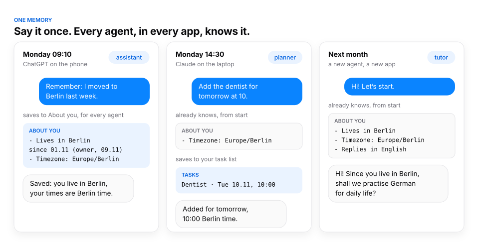
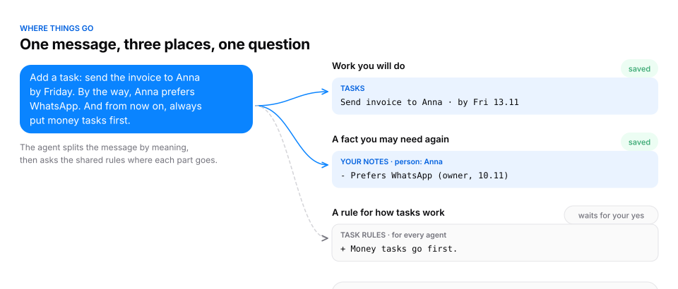
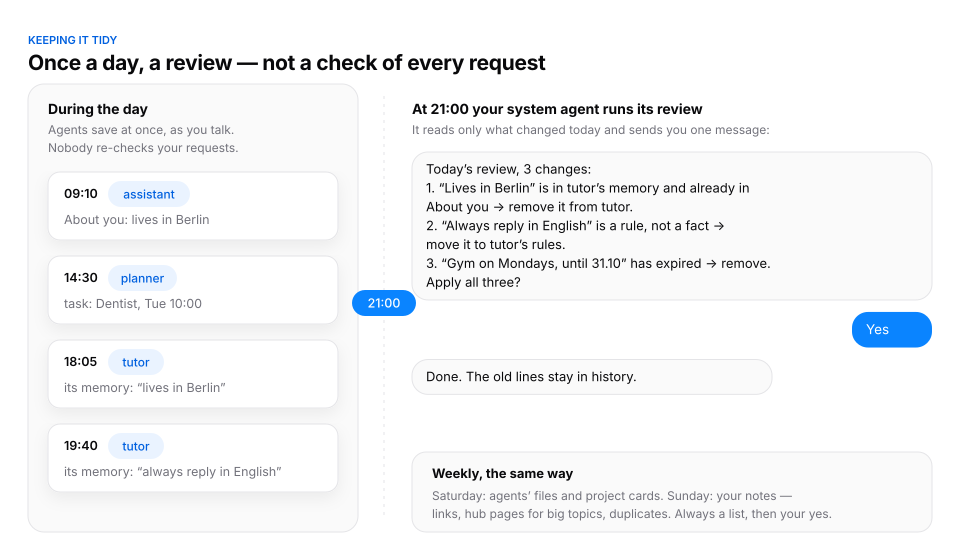

# ContextCore

**One memory for all your AI agents, on your own server.**

Your agents in Claude, ChatGPT, coding tools and any app with remote MCP servers read and write one place: facts
about you, your rules, notes, tasks, projects and skills. Tell one agent something, and every agent knows it.

<picture>
  <source media="(prefers-color-scheme: dark)" srcset="docs/one-memory-dark.svg">
  
</picture>

## The problem

You now work with several AI agents: a chat app on the phone, another one on the laptop, a coding agent, a bot
for your language lessons. Each one keeps its own memory, so:

- **You repeat yourself.** Your timezone, your projects, how you like answers: told again in every app.
- **Rules drift apart.** You correct one agent; the others keep the old way.
- **Memory turns into a pile.** Apps save whatever looks useful. Nobody merges, dates or removes it, and after a
  few months an agent quotes a fact that stopped being true.
- **An agent's guess looks like your words.** A note you wrote and a line a bot made up come back with the same
  weight.
- **You can't move.** Switch apps, and your agent starts from zero.

ContextCore is the one place behind all of them. An agent is a name, not an app: start "planner" in any app, and
it has the same rules, memory and records.

## How it works

**At the start of every chat** the agent calls `start` and reads its job, the facts about you, the shared rules,
its rights, its own memory, your projects and the time. No app memory is needed, so the same agent works the same
in any app.

<picture>
  <source media="(prefers-color-scheme: dark)" srcset="docs/at-start-dark.svg">
  
</picture>

**As it works**, the agent splits what you say by meaning and puts each part where it belongs: work goes to your
task list, a fact to your notes or to About you, a rule to the rules of that kind of work. Rules that every agent
follows wait for your yes; everything else is saved at once.

<picture>
  <source media="(prefers-color-scheme: dark)" srcset="docs/routing-dark.svg">
  
</picture>

Under the hood there are three tools. `start` gives the agent its rules and memory. `run` takes a short program
(`nm.read / list / find / write / save_task`) that reads and saves in one step, in a sandbox with no network or
files. `whats_new` shows what other agents changed. The server checks rights and formats; a refused save is never
half-done. Everything is Markdown and YAML in a git repo on your server, and every change is a version.

## Not everything weighs the same

Your own notes weigh most. An agent's memory and logs are useful, but never your words, and every search result
says which one it is. Project material counts only for its project. So an agent never passes its own guess off as
something you said.

## It stays tidy

<picture>
  <source media="(prefers-color-scheme: dark)" srcset="docs/review-dark.svg">
  
</picture>

Nobody checks your requests one by one: agents save at once, as you talk. Once a day, your system agent runs a
review of what changed since the last one and sends you one short list: a fact that is now in two places, a rule
saved as a fact, a fact past its date. You answer once. Weekly reviews do the same for agents' files, project cards
and your notes (links, hub pages for big topics, duplicates). Nothing changes before your yes, and history, like
past plans or lessons, is never removed.

## How it differs from other approaches

**Built-in app memory** (the memory of a chat app). Easy, and it works inside one app. It stays there: other apps
can't read it, you can't see or fix it as a whole, and nothing cleans it. ContextCore moves each app's memory in
at setup, and from then on the app keeps one line that points to ContextCore.

**Rules files** (CLAUDE.md, AGENTS.md, custom instructions). Clear and versioned, but one per tool or project,
copied by hand, and an agent can't save what it learns into them safely. In ContextCore the rules live in one
place, each agent reads only the rules of its own job and rights, and changes to shared rules wait for your yes.

**Vector memory services** (they extract snippets from chats and return similar ones). Good at recall, but the
memory is a cloud of fragments: no clear place for a rule, a task or a project, no idea which fragment is your word
and which is a model's guess, and usually someone else's server. ContextCore stores whole, readable files in
places you know, says where each item came from and when, and runs on your own server.

**A notes vault with an MCP server** (a folder of Markdown files that agents can read). Your files and your
structure, but every agent invents its own way to write there, so the vault slowly turns into a mix of styles,
duplicates and orphan notes. ContextCore gives every agent the same rules for where things go, types for notes,
dates and sources on facts, and a review that keeps it in order.

**ContextCore** is for a person who works with several agents across apps and wants one memory that they own, can
read, and that doesn't rot. It is not a team knowledge base and not a vector search engine.

## Install

Give your AI agent (one that can use a terminal and SSH, for example Claude Code) the link to this repo and say:

> Install ContextCore for me on my server. Follow INSTALL.md.

The agent asks you a few things (your server, an address, a name for your main agent), installs and checks the
server, connects your apps, and then helps you move in what you already have: each app's memory, your notes and
your projects.

## What is in this repo

- `server/`: the MCP server (three tools: start, whats_new, run) and a read-only page for your phone.
- `core/`: the rules engine: rights, formats, search, and the tool texts agents see.
- `seed/`: the starting store: shared rules, note types, task values and the skills the memory works by.
- `deploy/`: systemd and Caddy templates, an optional off-site backup.
- `docs/`: the diagrams above.
- `INSTALL.md`: the install guide, written for the agent.

License: MIT.
